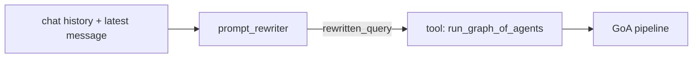
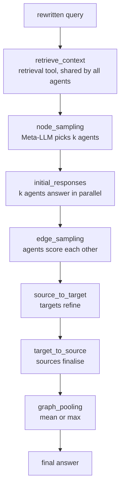

# Graph-of-Agents (GoA) Pipeline

Nash can answer a question with a **team** of specialist theology agents instead of a single LLM call.
The team works as a graph, following *Graph-of-Agents: A Graph-based Framework for Multi-Agent LLM
Collaboration* (Yun et al., ICLR 2026, [arXiv 2604.17148](https://arxiv.org/abs/2604.17148)):

- the **nodes** are agents (pastor, exegetes, systematic theologian, Westminster catechist, ...);
- the **edges** show whose answer each agent should learn from, decided by how the agents score each other.

All 40 hub agents run on the same vLLM model. They differ only in their system prompt
(`backend/configs/agent/hub/<role>.yaml`) and their JSON output schema (`backend/configs/schema/hub/`).

## Where the code lives

```
backend/
├── pipelines/agentic/
│   ├── GoA_pipeline.py                  # LangGraph graph + run_goa() + FastAPI router + demo
│   ├── states/goa_state.py              # GoAState: the data passed between nodes
│   └── services/
│       ├── node_sampling_service.py     # 1. choose k agents from their model cards
│       ├── response_service.py          # 2. every agent answers on its own
│       ├── edge_sampling_service.py     # 3. agents score each other -> relevance + edges
│       ├── message_passing_service.py   # 4. source -> target, then target -> source
│       ├── graph_pooling_service.py     # 5. mean or max pooling -> one answer
│       ├── agent_pool.py                # load agents, call them in parallel, format answers
│       └── prompts.py                   # every user-prompt template
├── services/prompt_rewrite_service.py   # chat history + message -> self-contained question
├── configs/tools/run_GoA.py             # the LLM tool (schema + executor + HTTP route)
├── configs/agent/agents.yaml            # model cards of the hub agents
├── configs/agent/main/                  # node_sampler, graph_pooler, prompt_rewriter
└── utils/goa_configs.py                 # every tunable number and path
```

## Before GoA: the prompt rewriter

The GoA tool only accepts a **rewritten** question. In a chat, a message such as *"How does that fit with James 2:24?"*
means nothing without the earlier turns. `rewrite_prompt(message, history)` turns it into something like
*"Does justification by faith in Romans 3:28 contradict James 2:24?"*. With no history, no LLM call is made.



## Flow



The graph is a straight line, because every step needs the result of the step before it. The parallel work
(several agents at once) happens *inside* each node with a thread pool. vLLM batches these requests on the GPU.
Each stage writes the agents' answers under its own state key (`initial_responses`, then `forward_responses`,
then `final_responses`), so nothing is overwritten. This lets the demo show how every agent's answer changed.

### 0. Shared retrieval
The knowledge base is searched **once** with the rewritten query, through `execute_retrieval_tool` (see
[pipeline.md](pipeline.md)). Every agent gets the same `[V1]..` / `[G1]..` context, so their citations can be compared.

### 1. Node sampling
The `node_sampler` agent reads the question and the model cards in `agents.yaml`, and picks the k best agents:

$$V_s = \text{MetaLLM}(\text{Top-}k \mid Q, \text{model cards})$$

Unknown or duplicate roles are dropped. If too few are left, the list is filled with `general_theologian` and then
the other agents.

### 2. Initial responses
Every selected agent answers on its own in its own JSON schema. All schemas contain `reasoning`, `answer`,
`confidence` and Scripture references.

### 3. Edge sampling
Every agent *i* scores every **other** agent *j*'s answer from 0 to 1 (`schema/main/edge_scoring.schema.json`). The
answers are shown anonymously as R1, R2, ... and an agent never scores itself. Then:

1. **Normalise.** Each scorer's row is divided by its sum, so every agent has the same voting power.
2. **Relevance.** $S_j = \sum_{i \ne j} \text{score}(i \to j)$. This is how much the others trust agent *j*. The average is exactly 1.
3. **Prune.** Agents with $S_j < \tau$ are removed ($\tau$ = `EDGE_THRESHOLD` = 0.05, as in the paper). The top agent is always kept.
4. **Edges.** The agents are sorted by *S*. Each agent is a **source** for every less relevant agent (its **targets**). The weight
   $$A_{ij} = \frac{S_i}{\sum_{k \in \text{sources}(j)} S_k}$$
   says how much target *j* should listen to source *i*. The weights going into one target sum to 1.

Example: with $S_A = 1.2$, $S_B = 1.1$, $S_C = 0.7$, the edges are A→B (1.00), A→C (0.52) and B→C (0.48).

### 4. Message passing
1. **Source → target.** Every target reads its sources' initial answers and refines its own.
2. **Target → source.** Every source reads how its targets refined their answers after seeing its answer, and
   finalises its own. *Note:* the paper refines the source's *initial* answer here. We pass its *latest*
   answer instead, so an agent in the middle of the ranking keeps what it learned in step 1.

Each neighbour's answer is labelled with its edge weight: high (> 0.7), moderate (> 0.4) or low.

### 5. Graph pooling
| Method | How | Cost |
|---|---|---|
| `mean` (default) | the `graph_pooler` Meta-LLM synthesises all final answers, weighted by $S$ | 1 extra LLM call |
| `max` | the final answer of the most relevant agent | free |

## Error handling
| Problem | What happens |
|---|---|
| retrieval fails | agents answer without context, and a message is added to `errors` |
| node sampler fails | the generalist and other agents are used |
| one agent fails to answer | it is left out of the graph. If **all** fail, the request fails (HTTP 503) |
| one scorer fails | it gives everyone equal scores |
| one refinement fails | that agent keeps its previous answer |
| mean pooling fails | max pooling is used |

## Endpoints
| Route | What |
|---|---|
| `POST /api/goa/run` | full run with every intermediate answer (`agent_outputs`, `score_matrix`, `edges`, `timings`, ...) |
| `GET /api/goa/agents` | the model cards |
| `GET /api/goa/health` | LLM server, agent configs, retrieval |
| `POST /api/tools/goa` | the LLM tool: a compact result (final answer, agents, relevance, source labels) |
| `GET /api/tools/goa/schema` | the tool definition sent to the LLM |

## Demo
Run from the repository root (the agent configs use paths relative to it):

```bash
# history.json: [{"role": "user", "content": "What does Romans 3:28 teach?"},
#                {"role": "assistant", "content": "...justified by faith apart from works..."}]
python -m backend.pipelines.agentic.GoA_pipeline "How does that fit with James 2:24?" \
    --history history.json --k 3 --pooling mean --save result.json
```

It prints the rewritten query, the tool call, the RAG sources, the selected agents, every initial answer, the score
matrix, the relevance table, the edges, both refinements, the final answer with references, and the time per node.
A run with k = 3 takes about 40–75 s on Llama-3.1-8B.

## Tunable parameters (`backend/utils/goa_configs.py`)
| Name | Default | Meaning |
|---|---|---|
| `DEFAULT_K` / `MAX_K` | 3 / 5 | agents per question (the paper uses 3) |
| `EDGE_THRESHOLD` | 0.05 | prune agents with relevance below this |
| `DEFAULT_POOLING` | `mean` | `mean` or `max` |
| `HIGH_RELEVANCE` / `MODERATE_RELEVANCE` | 0.7 / 0.4 | edge-weight labels in message passing |
| `MAX_PEER_RESPONSE_CHARS` | 1500 | a peer's answer is cut to this length |
| `SCORING_MAX_TOKENS` | 256 | token budget of one scoring call |
| `MAX_PARALLEL_AGENTS` | 8 | threads used to call agents at the same time |
