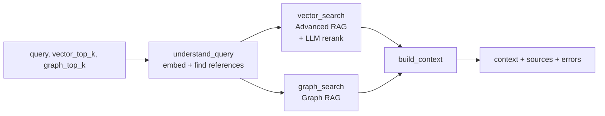

# RAG Pipeline: Advanced RAG + Graph RAG

Nash answers questions from three bodies of knowledge:

| Store | Database | What is inside | Searched by |
|---|---|---|---|
| Sermons | Postgres `nash_sermons` (`chunks`, `videos`, `verse_mentions`) | Sermon transcript chunks with pgvector embeddings | **Advanced RAG** |
| Westminster Standards | Postgres `nash-westminster` (`units`, `proofs`) | Confession (WCF), Larger (WLC) and Shorter (WSC) Catechism | **Advanced RAG** |
| Bible | Neo4j (`:Verse`, `[:CROSS_REFERENCE_TO]`) | Every verse (BSB + TB) and its cross-references | **Graph RAG** |

The pipeline runs both techniques at the same time and returns one combined, citable context.

## Where the code lives

```
backend/
├── pipelines/rag/
│   ├── rag_pipeline.py          # builds the graph + service functions + FastAPI router
│   ├── states/rag_state.py      # RAGState: the data passed between nodes
│   └── nodes/
│       ├── understand_query.py  # 1. embed the query, find Bible references in it
│       ├── vector_search.py     # 2a. Advanced RAG (hybrid search -> RRF -> LLM rerank -> MMR)
│       ├── graph_search.py      # 2b. Graph RAG (seeds -> expansion -> bridge)
│       └── build_context.py     # 3. numbered context blocks + structured sources
├── configs/tools/retrieval.py   # the LLM tool (schema + executor + HTTP route)
├── configs/agent/main/reranker.yaml  # prompt + settings of the LLM reranker
├── services/rerank_service.py   # LLM-as-reranker (scores passages 0..1)
├── database/neo4j/get_connection.py
└── utils/rag_configs.py         # all SQL / Cypher queries and tunable numbers
```

## Flow



The pipeline is a [LangGraph](https://langchain-ai.github.io/langgraph/) `StateGraph`. `vector_search` and
`graph_search` both start after `understand_query` and run **in parallel**; `build_context` waits for both.
Every node is wrapped with `@log_node(...)`, so its latency is written to `backend/core/logging/node_metrics.jsonl`.

## Step 1: Understand the query (`understand_query.py`)

1. **Embedding.** The query is embedded once with the existing `EmbeddingService`, and the same vector is
   reused by both branches.
2. **Bible references.** References written in the query are turned into verse ids, for example
   `"Romans 3:28"` becomes `Rom.3.28` and `"Efesus 2:8-9"` becomes `Eph.2.8, Eph.2.9`. This uses the same
   regular expression as sermon ingestion (`MENTION` in `utils/sermon_postgres_configs.py`), so English and
   Indonesian book names both work.

## Step 2a: Advanced RAG over the vector database (`vector_search.py`)

Naive RAG returns the *k* nearest embeddings. Advanced RAG adds four improvements:

```
hybrid search (4 lists) → RRF → best 20 candidates → LLM rerank → MMR → vector_top_k results
```

### Hybrid search

For **each** source (sermons and Westminster), two searches are run:

| Search | How | Good at |
|---|---|---|
| Dense | `ORDER BY embedding <=> query_vector` (pgvector cosine distance) | meaning, paraphrases, other languages |
| Keyword | `search @@ websearch_to_tsquery(...)`, ranked by `ts_rank_cd` | exact words, names, rare terms |

Each search returns `vector_top_k × CANDIDATE_MULTIPLIER` candidates, so there are 4 ranked lists in total.

### Reciprocal Rank Fusion (RRF)

The 4 lists are merged with

$$\text{RRF}(d) = \sum_{\text{lists } L} \frac{1}{k + \text{rank}_L(d)} \qquad (k = 60)$$

A document found near the top of several lists gets the highest score. RRF only uses **ranks**, so it does
not matter that cosine similarity and `ts_rank_cd` use completely different scales.

### LLM reranking (`services/rerank_service.py`)

Embeddings compress the question and each passage **separately** and compare them afterwards. A reranker reads
the question and the passage **together**, so it can tell whether the passage actually *answers* the question.
Instead of loading a separate cross-encoder model, Nash reuses the LLM that is already running (vLLM, served
name `llm`), which saves GPU memory.

The best `max(RERANK_CANDIDATES, 2 × vector_top_k)` fused candidates are scored. Each one is a separate
request, and they are all sent in parallel:

1. **Prompt.** The prompt is in `configs/agent/main/reranker.yaml`. It asks the LLM to rate the passage:
   0 = unrelated, 1 = same topic but does not help, 2 = partly answers, 3 = directly answers.
2. **One forced token.** `max_tokens=1` and the vLLM structured output `{"choice": ["0","1","2","3"]}` force
   the answer to be exactly one digit.
3. **Probabilities, not just the digit.** With `logprobs=True`, vLLM returns the probability of each digit,
   and the score is the expected rating scaled to 0..1:

$$\text{score}(d) = \frac{0 \cdot p_0 + 1 \cdot p_1 + 2 \cdot p_2 + 3 \cdot p_3}{3}$$

   Two passages that are both rated "2" can still be ordered, because the LLM is more sure about one of them.

vLLM batches the parallel requests on the GPU and reuses the shared system prompt through prefix caching.
Reranking 20 candidates adds roughly 0.5 s.

Example (Indonesian query *"Bagaimana orang berdosa dibenarkan di hadapan Allah?"*):

| | 1st result without reranking | 1st result with reranking |
|---|---|---|
| passage | a sermon chunk on universal sin (similarity 0.668) | WLC 73 *"How doth faith justify a sinner in the sight of God?"* (rerank 0.94; it was 5th before) |

If the LLM server is down, reranking is skipped and an error is added to `errors`. MMR then falls back to
embedding similarity. Reranking can be switched off per request (`"rerank": false`), or globally with the
env var `RAG_RERANK=false`.

### Maximal Marginal Relevance (MMR)

The final `vector_top_k` passages are picked one at a time. Each step picks the candidate with the best

$$\text{MMR}(d) = \lambda \cdot \text{rel}(d) - (1-\lambda) \cdot \max_{s \in \text{selected}} \text{sim}(d, s) \qquad (\lambda = 0.7)$$

`rel(d)` is the LLM rerank score, or the cosine similarity to the query when reranking is off.
The first term rewards relevance. The second term punishes passages that repeat what has already been
picked, such as two neighbouring chunks of the same sermon.

Each vector result reports three scores:
- `similarity` is the cosine similarity to the query;
- `rrf_score` is the fusion score;
- `rerank_score` is the LLM score, or `null` when reranking is off.

## Step 2b: Graph RAG over the knowledge graph (`graph_search.py`)

Vector search only finds verses that *sound like* the question. The graph also finds verses that are
*connected to* the relevant ones through cross-references.

1. **Seeds.** These are the starting verses.
   - Verses written in the query are always seeds, with score 1.0. Ids that don't exist are dropped.
   - The closest verses from the Neo4j vector index `verse_embedding` fill the remaining seed slots, with
     score equal to their similarity.
   - Seeds take about half of the result slots: `max(1, graph_top_k // 2)`.
2. **Expansion.** The pipeline follows one hop of `CROSS_REFERENCE_TO` from every seed, and scores each
   neighbour as
   $$\text{score}(n) = \text{HOP\_DECAY} \times \sum_{\text{seeds } s \to n} \text{score}(s) \qquad (\text{HOP\_DECAY} = 0.5)$$
   A verse connected to **several** seeds is a "hub" verse, so it ranks higher.
3. **Selection.** Seeds come first, then the best neighbours. If there aren't enough neighbours, the
   remaining slots are filled with more semantic matches, so the caller always gets up to `graph_top_k` verses.
4. **Bridge back to the documents.** For every chosen verse, Postgres is asked which Westminster units cite it
   (`proofs`) and which sermon chunks mention it (`verse_mentions`), up to 3 of each. This links the graph
   results to the documents of the vector database.

Each verse result explains *why* it was chosen in its `relation` field. The possible values are
`referenced in the query`, `semantic match` and `cross-reference of Rom.3.28, Eph.2.8`.

## Step 3: Build the context (`build_context.py`)

Both result lists become numbered blocks that the LLM can cite:

```
[V1] Westminster Standards — Westminster Shorter Catechism WSC.33
Q. What is justification? A. Justification is an act of God's free grace...

[G1] Bible — Romans 3:28 (<pericope heading>)
Relation: referenced in the query
BSB: <English verse text>
TB: <Indonesian verse text>
Cited by: Westminster Confession of Faith WCF.11.1; ...

[G2] Bible — Galatians 2:16 (<pericope heading>)
Relation: cross-reference of Rom.3.28
...
```

`[V…]` blocks come from the vector database and `[G…]` blocks come from the knowledge graph. Each passage is
cut to `MAX_PASSAGE_CHARS`. The same items are also returned as a structured `sources` list.

## Error handling (graceful degradation)

Each search branch catches its own database errors. If Neo4j is down, for example, `graph_search` returns no
verses and adds a message to `errors`. The vector results are still returned, so the LLM can still answer.
`errors` uses a LangGraph list reducer (`Annotated[list[str], operator.add]`), so messages from both parallel
branches are kept.

The only hard failure is the embedding server, because both branches need the query vector. In that case
`retrieve()` raises an error, and the tool returns `{"error": ...}`.

## Tunable parameters (`backend/utils/rag_configs.py`)

| Name | Default | Meaning |
|---|---|---|
| `DEFAULT_TOP_K` | 5 | results per branch when the caller does not choose |
| `MAX_TOP_K` | 20 | upper limit for `vector_top_k` / `graph_top_k` |
| `CANDIDATE_MULTIPLIER` | 4 | candidates fetched per search = `top_k × 4` |
| `RRF_K` | 60 | RRF constant; larger values flatten the rank differences |
| `MMR_LAMBDA` | 0.7 | 1.0 = relevance only, 0.0 = diversity only |
| `RERANK_ENABLED` | env `RAG_RERANK`, default `true` | use the LLM reranker by default |
| `RERANK_CANDIDATES` | 20 | fused candidates scored by the LLM (at least `2 × vector_top_k`) |
| `MAX_RERANK_DOCUMENTS` | 50 | limit for `POST /api/rag/rerank` |
| `reranker.yaml` → `generation` | | prompt, `max_workers` (16 parallel requests), `max_passage_chars` (1500), timeout |
| `HOP_DECAY` | 0.5 | how much a cross-reference is worth compared with its seed |
| `LINKED_SOURCES_PER_VERSE` | 3 | citing Westminster units / sermon chunks listed per verse |
| `MAX_PASSAGE_CHARS` | 1200 | maximum characters per passage in the context |
| `SERMON_DB`, `WESTMINSTER_DB` | env | Postgres database names |
| `NEO4J_URI`, `NEO4J_USER`, `NEO4J_PASSWORD` | env | Neo4j connection |

## Prerequisites

The pipeline reads the data loaded by the ingestion services:

```bash
python -m backend.services.push_sermon_postgres_service all
python -m backend.services.push_westminster_postgres_service all
python -m backend.services.push_bible_neo4j_service all
```

The embedding server (`EMBEDDING_URL`) must also be running, and must be the same model that produced the
stored embeddings.

> The graph seed search uses the Cypher 25 `SEARCH` clause (`MATCH (node:Verse) SEARCH node IN (VECTOR INDEX
> verse_embedding FOR $vector LIMIT $limit) SCORE AS score`), which replaces the deprecated
> `db.index.vector.queryNodes` procedure. The query starts with `CYPHER 25`, so it also works on databases
> whose default language is still Cypher 5.
>
> pgvector returns stored embeddings as `pgvector.Vector` objects; `vector_search.py` converts them to numpy
> arrays (`to_numpy`) before computing MMR similarities.

## Quick test

```bash
# unit tests (no databases needed)
pytest tests/pipelines/test_rag.py

# one real query from the command line
python -m backend.pipelines.rag.rag_pipeline "What is justification by faith? Romans 3:28" --vector-top-k 4 --graph-top-k 6
```
